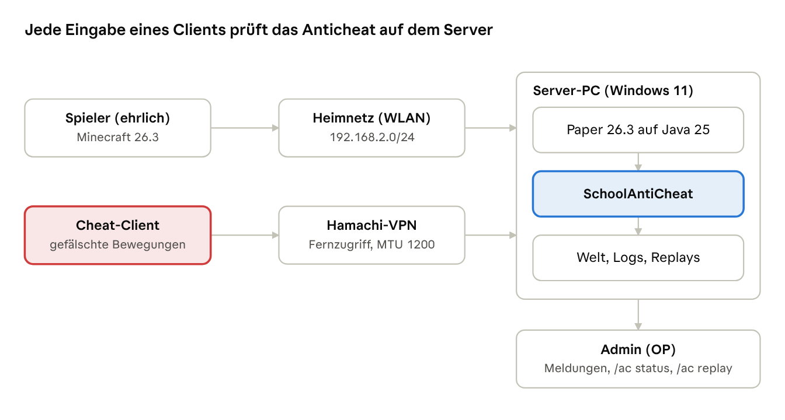
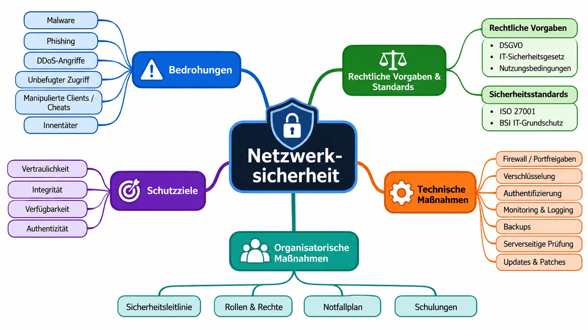
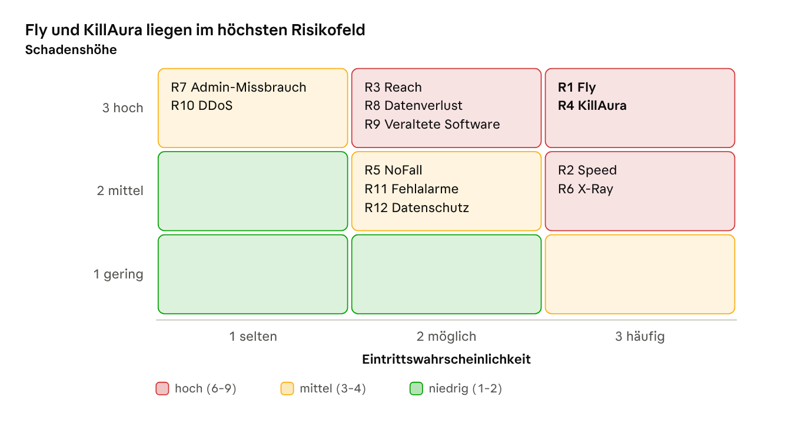
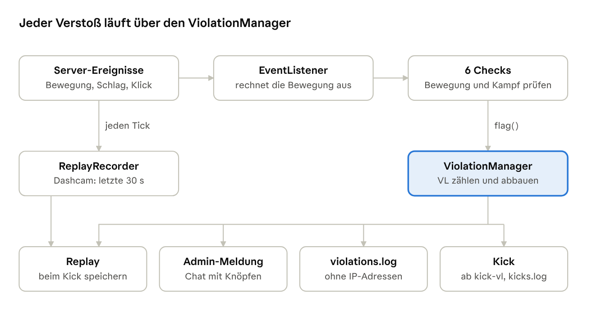

# Projektdokumentation LF11 – Absicherung eines Minecraft-Servers gegen Cheat-Clients

Stand: 26.11.2026 · Online-Version mit Kommentarfunktion: [Claude-Dokument](https://claude.ai/artifact/3HijpgJ8Sb5QPsdXfPhyqB)

Wir haben einen Minecraft-Server als vernetztes System gegen manipulierte Clients abgesichert: Risikoanalyse nach BSI, ein selbst entwickeltes serverseitiges Anticheat mit sechs Checks und eine Live-Prüfung mit einem öffentlich verfügbaren Cheat-Client.

| Angabe | Inhalt |
| --- | --- |
| Lernfeld | LF11 FISI – Betrieb und Sicherheit vernetzter Systeme gewährleisten |
| Szenario | X – Betrieb eines frei gewählten vernetzten Systems absichern |
| Projekt | SchoolAntiCheat – serverseitiges Anticheat für Paper-Server |
| Team | Marcel (@leyxh1), Niklas (@salkinhopsongit) |
| Klasse / Lehrkraft | _eintragen_ |
| Abgabedatum | _eintragen_ |
| Repository | [github.com/leyxh1/MinecraftACSchule](https://github.com/leyxh1/MinecraftACSchule) |
| System | Paper 26.3 (Build 246), Java 25, Windows 11, Plugin v0.1.0 |

**Inhalt:** 1 Einleitung · 2 Gewähltes System · 3 Informationssicherheit · 4 IST-Zustand und Schutzbedarf · 5 Risikoanalyse · 6 Soll-Zustand · 7 Maßnahmen · 8 Umsetzung · 9 Prüfung · 10 Bewertung · 11 Projektorganisation · 12 Fazit · 13 Quellen

## 1 Einleitung und Auftrag

Ziel war, ein selbst gewähltes vernetztes System zu analysieren, seinen Schutzbedarf zu bestimmen, Maßnahmen exemplarisch umzusetzen und das erreichte Sicherheitsniveau zu bewerten.

In Szenario X verlangt der Arbeitsauftrag, dass wir:

1. ein vernetztes System wählen und seine Komplexität mit dem Lehrerteam abstimmen,
2. gemeinsam Sicherheitskriterien (Soll-Zustand) festlegen,
3. uns über Standards zur Informationssicherheit informieren (BSI),
4. den IST-Zustand aufnehmen und Risiken benennen (Schutzbedarfsanalyse),
5. Maßnahmen unter Beachtung einer Sicherheitsleitlinie und rechtlicher Regelungen planen und exemplarisch durchführen,
6. die Sicherheit prüfen und Sicherheitsniveau sowie Wirtschaftlichkeit bewerten,
7. alles dokumentieren und das Lehrerteam informieren.

Unser Thema ist ein Grundproblem vieler vernetzter Systeme: Ein Server muss mit Geräten kommunizieren, die er nicht kontrolliert. Ein Minecraft-Server zeigt das anschaulich, weil sich Angriffe mit einem Cheat-Client live und wiederholbar vorführen lassen.

Wir sind nach der vollständigen Handlung vorgegangen:

| Phase | Tätigkeit | Kapitel |
| --- | --- | --- |
| Informieren | Brainstorming, BSI-Standards, Cheat-Arten | 3 |
| Planen | IST-Zustand, Schutzbedarf, Risiken, Soll-Zustand | 4–6 |
| Entscheiden | Maßnahmen auswählen und abstimmen | 7 |
| Durchführen | Testserver härten, Anticheat programmieren | 8 |
| Kontrollieren | Tests mit Cheat-Client und normalem Spiel | 9 |
| Bewerten | Sicherheitsniveau, Wirtschaftlichkeit, Grenzen | 10 |

## 2 Gewähltes System und Komplexität

Unser System ist ein Minecraft-Multiplayer-Server (Paper 26.3) auf einem Windows-PC, der im LAN und über das Internet von Clients erreicht wird, die der Betreiber nicht kontrollieren kann.

Ehrliche Spieler und der Cheat-Client erreichen den Server über das Heimnetz oder Hamachi; jede Bewegung prüft das Anticheat, bevor sie in Welt, Logs und Replays landet.

| Komponente | Umsetzung |
| --- | --- |
| Server-Hardware | Windows-11-PC, AMD Ryzen 7 7800X3D, 31 GB RAM |
| Laufzeit | Java 25 (Eclipse Temurin) |
| Server-Software | Paper 26.3, Build 246 |
| Schutzmaßnahme | eigenes Plugin SchoolAntiCheat v0.1.0 |
| Netzwerk | WLAN 192.168.2.0/24, Router als Gateway, TCP-Port 25565 |
| Fernzugriff | Hamachi-VPN (virtuelles LAN, Adapter 25.x.x.x) |
| Clients | Minecraft Java 26.3, davon einer mit Cheat-Client |
| Daten | Spielwelt, Spielerdaten (Name, UUID), Logdateien, Konfiguration |

**Warum das System komplex genug ist:**

- Es besteht aus mehreren Schichten: Betriebssystem, Java, Server-Software, Plugins, Netzwerk und Clients.
- Client und Server kommunizieren über ein Netzwerkprotokoll (TCP) mit nicht vertrauenswürdigen Gegenstellen.
- Alle Schutzziele sind betroffen: Integrität, Verfügbarkeit, Vertraulichkeit und Authentizität.
- Es werden personenbezogene Daten verarbeitet, also gilt die DSGVO.
- Die Schutzmaßnahme ist selbst programmiert, nicht nur konfiguriert.
- Angriffe lassen sich live und wiederholbar nachstellen und prüfen.

| Abstimmung mit dem Lehrerteam | |
| --- | --- |
| Datum | _eintragen_ |
| Lehrkraft | _eintragen_ |
| Ergebnis | _Komplexität ausreichend / Erweiterung nötig_ |

## 3 Informationssicherheit

Der Grundsatz unseres Projekts lautet „Never trust the client“: Alles, was vom Client kommt, kann gefälscht sein, deshalb prüft der Server spielrelevante Eingaben selbst.

**Sprint 0 – Brainstorming:** Jeder hat zuerst allein gesammelt, danach haben wir eine gemeinsame Mindmap „Netzwerksicherheit“ erstellt (Think-Pair-Square). Sie hat sechs Äste: Bedrohungen, Schutzziele, technische Maßnahmen, organisatorische Maßnahmen, rechtliche Vorgaben und Standards. Aus dem Ast „Manipulierte Clients / Cheats“ ist unser Szenario entstanden.

**Schutzziele, übertragen auf den Server:**

| Schutzziel | Bedeutung auf unserem Server | Bedrohung durch Cheats |
| --- | --- | --- |
| Integrität | Spielzustand (Position, Schaden, Leben) folgt den Spielregeln | Hauptproblem: Fly, Speed, Reach, KillAura, NoFall verfälschen ihn |
| Verfügbarkeit | Server läuft, ehrliche Spieler können spielen | Cheater vertreiben Spieler; Paket-Spam kann den Server belasten |
| Vertraulichkeit | Spielerdaten, Admin-Zugang, Logdateien | X-Ray/ESP zeigt verborgene Informationen (nicht Teil des Projekts) |
| Authentizität | Spieler ist, wer er vorgibt zu sein | Gefälschte Accounts, wenn `online-mode` aus ist |

**Genutzte Standards:**

| Quelle | Wofür |
| --- | --- |
| BSI-Standard 200-1 | Begriffe, Sicherheitsleitlinie |
| BSI-Standard 200-2 | IT-Grundschutz-Methodik, Schutzbedarfskategorien |
| BSI-Standard 200-3 | Vorgehen bei der Risikoanalyse |
| IT-Grundschutz-Kompendium | Bausteine als Ideenquelle, z. B. Allgemeiner Server, Patch- und Änderungsmanagement, Protokollierung, Datenschutz, Datensicherung, Firewall |

## 4 IST-Zustand und Schutzbedarfsanalyse

Ein frisch aufgesetzter Paper-Server erkennt keine Cheat-Clients; der Schutzbedarf der Integrität des Spielzustands ist deshalb **hoch**.

**IST-Zustand vor unseren Maßnahmen:**

| Bereich | IST-Zustand | Bewertung |
| --- | --- | --- |
| Cheat-Erkennung | keine; Paper prüft Bewegungen nur grob („moved too quickly“) | Fly, Speed, Reach, KillAura, NoFall bleiben unbemerkt |
| Admin-Benachrichtigung | keine | Cheats fallen nur zufällig auf |
| Protokollierung | Standard-Serverlog mit IP-Adressen (`log-ips=true`) | keine Auswertung, IPs ohne Hinweis gespeichert |
| Zugang | keine Whitelist | jeder mit Account kann joinen |
| Authentifizierung | `online-mode=true` | in Ordnung |
| Fernwartung | RCON aus | in Ordnung |
| Paketschutz | Paper-Paketlimit 500 Pakete/s | schützt vor Spam, erkennt aber keinen konkreten Cheat |
| Datensicherung | keine | Welt bei Defekt verloren |

**Schutzbedarfskategorien nach BSI-Standard 200-2:** normal = begrenzte Schäden, hoch = beträchtliche Schäden, sehr hoch = existenzbedrohende Schäden.

| Schutzobjekt | Vertraulichkeit | Integrität | Verfügbarkeit | Begründung |
| --- | --- | --- | --- | --- |
| Spielzustand (Bewegung, Kampf) | normal | **hoch** | normal | Manipulation zerstört Fairness, Spieler wandern ab |
| Spielwelt | normal | **hoch** | hoch | viele Stunden Arbeit, ohne Backup verloren |
| Spielerdaten (Name, UUID, IP) | **hoch** | normal | normal | personenbezogene Daten, DSGVO |
| Anticheat-Logs und Replays | hoch | **hoch** | normal | Grundlage für Kicks und Banns, dürfen nicht verfälscht werden |
| Admin-Zugang (OP, Konsole) | **sehr hoch** | **sehr hoch** | hoch | wer Admin ist, kontrolliert alles |
| Server-PC und Netzwerk | normal | normal | hoch | Ausfall = Server offline |

Daraus folgt: Für den hohen Schutzbedarf des Spielzustands ist eine technische Maßnahme nötig, das Anticheat. Die übrigen Objekte sichern wir mit Basismaßnahmen ab.

## 5 Risikoanalyse

Die größten Risiken sind Fly und KillAura (je 9 von 9 Punkten); vier der sieben hohen Risiken verringern wir direkt mit dem Anticheat.

Bewertet nach BSI-Standard 200-3 mit Risiko = Eintrittswahrscheinlichkeit (W) × Schadenshöhe (S), jeweils 1 = gering bis 3 = hoch. Ergebnis 1–2 = niedrig, 3–4 = mittel, 6–9 = hoch.

| Nr. | Bedrohung | Schutzziel | W | S | Risiko | Behandlung |
| --- | --- | --- | --- | --- | --- | --- |
| R1 | Fly-Hack | Integrität | 3 | 3 | 9 hoch | Fly-Check |
| R4 | KillAura / Autoclicker | Integrität | 3 | 3 | 9 hoch | KillAura- und AutoClicker-Check |
| R2 | Speed-Hack | Integrität | 3 | 2 | 6 hoch | Speed-Check |
| R3 | Reach | Integrität | 2 | 3 | 6 hoch | Reach-Check |
| R6 | X-Ray / ESP | Vertraulichkeit | 3 | 2 | 6 hoch | akzeptiert (Grenze) |
| R8 | Datenverlust der Welt | Verfügbarkeit | 2 | 3 | 6 hoch | Backups |
| R9 | Veraltete Software / Plugins | alle | 2 | 3 | 6 hoch | Updates, offizielle Quellen, Prüfsumme |
| R5 | NoFall | Integrität | 2 | 2 | 4 mittel | NoFall-Check |
| R11 | Fehlalarme sperren ehrliche Spieler aus | Verfügbarkeit | 2 | 2 | 4 mittel | Toleranzen, Puffer, nur Kick |
| R12 | Unzulässige Speicherung personenbezogener Daten | Vertraulichkeit | 2 | 2 | 4 mittel | Logs ohne IP, `log-ips=false` |
| R7 | Missbrauch von Admin-Rechten | alle | 1 | 3 | 3 mittel | Rollen, wenige OPs |
| R10 | DDoS auf Port 25565 | Verfügbarkeit | 1 | 3 | 3 mittel | übertragen (Hamachi statt offener Port) |

Die Bewegungs- und Kampf-Cheats liegen fast alle in den roten Feldern oben rechts; genau dort setzt das Anticheat an.

**Risikobehandlung:** Vermindern ist unsere Hauptstrategie (Anticheat, Backups, Updates). Vermeiden setzen wir mit der Whitelist um, übertragen mit Hamachi statt einem offenen Port. Bewusst akzeptiert werden X-Ray und Cheats, die knapp unter den Grenzwerten bleiben.

## 6 Soll-Zustand (Sicherheitskriterien)

Nach der Umsetzung soll der Server zehn messbare Kriterien erfüllen; sie sind mit dem Lehrerteam abzustimmen und werden in Kapitel 9 einzeln geprüft.

| Nr. | Kriterium | Messbar durch | Schutzziel |
| --- | --- | --- | --- |
| S1 | Fly, Speed, Reach, KillAura/Autoclicker und NoFall werden erkannt | mind. 4 von 5 Cheat-Arten lösen eine Meldung aus | Integrität |
| S2 | Wiederholte Verstöße führen automatisch zum Kick | Kick bei Erreichen von `kick-vl` | Integrität |
| S3 | Normales Spielen führt zu keinem Kick | 0 Kicks bei den Fehlalarm-Tests | Verfügbarkeit |
| S4 | Admins werden sofort informiert | Chat-Meldung an Spieler mit `schoolanticheat.alerts` | Integrität |
| S5 | Verstöße und Kicks sind nachvollziehbar | `violations.log`, `kicks.log`, Replay | Nachvollziehbarkeit |
| S6 | Protokollierung ist datensparsam | keine IP-Adressen in Anticheat- und Serverlog | Vertraulichkeit, DSGVO |
| S7 | Grenzwerte ohne Programmierung anpassbar | Änderung in `config.yml` + `/ac reload` | Betrieb |
| S8 | Nur echte Accounts und freigeschaltete Spieler | `online-mode=true`, Whitelist an | Authentizität |
| S9 | Keine unnötigen Dienste von außen erreichbar | RCON und Query aus, kein offener Router-Port | Vertraulichkeit, Verfügbarkeit |
| S10 | Code-Änderungen nur nach Vier-Augen-Prinzip | Branch-Schutz: Pull Request, Approval, grüner Build | Integrität |

| Abstimmung Soll-Zustand | |
| --- | --- |
| Datum | _eintragen_ |
| Änderungen durch das Lehrerteam | _eintragen_ |

## 7 Maßnahmen

Unsere Hauptmaßnahme ist das selbst entwickelte Anticheat; dazu kommen eine Sicherheitsleitlinie, Basishärtung des Servers und Regeln für Datenschutz und Entscheidungen.

**IT-Sicherheitsleitlinie für den Serverbetrieb:**

1. **Fairness:** Nur unveränderte Clients sind erlaubt. Verstöße werden automatisch erkannt und führen zum Kick.
2. **Never trust the client:** Spielrelevante Eingaben prüft der Server selbst.
3. **Minimale Rechte:** Admin-Rechte (OP) bekommen nur namentlich benannte Personen.
4. **Aktualität:** Software nur aus offiziellen Quellen, mit Prüfsumme, zeitnah aktualisiert.
5. **Datensicherung:** Die Welt wird regelmäßig gesichert.
6. **Datensparsamkeit:** Nur nötige personenbezogene Daten werden gespeichert, keine IP-Adressen.
7. **Nachvollziehbarkeit:** Verstöße und Kicks werden protokolliert und aufgezeichnet.
8. **Mensch entscheidet:** Dauerhafte Sperren verhängt nur ein Admin, nie das System allein.

**Technische Maßnahmen:**

| Maßnahme | gegen | Kriterium |
| --- | --- | --- |
| Anticheat mit sechs Checks | R1–R5 | S1 |
| Violation-Level mit Abbau, Kick ab Grenzwert | R1–R5, R11 | S2, S3 |
| Admin-Meldungen im Chat | R1–R5 | S4 |
| `violations.log`, `kicks.log`, Replays | R7, R11 | S5 |
| Grenzwerte in `config.yml` | R11 | S7 |
| `online-mode=true`, Whitelist | Authentizität | S8 |
| RCON und Query aus, Hamachi statt offenem Port | R9, R10 | S9 |
| `log-ips=false` im Server | R12 | S6 |
| Paper-Download über offizielle API mit SHA-256-Prüfung | R9 | – |
| Branch-Schutz und automatischer Build auf GitHub | R9 | S10 |

**Organisatorische Maßnahmen:** Serverregeln mit Cheat-Verbot und Hinweis auf die Protokollierung, feste Admin-Rollen, Admins prüfen Meldungen und Replay vor einem Bann, Logs werden regelmäßig ausgewertet und nach einer festen Frist gelöscht.

**Rechtliche Regelungen:**

| Regelung | Bedeutung | Umsetzung |
| --- | --- | --- |
| DSGVO Art. 5 (Datenminimierung, Speicherbegrenzung) | nur nötige Daten, nicht unbegrenzt | Logs nur mit Name, Check, Zeit; Replays automatisch auf 50 begrenzt |
| DSGVO Art. 6 Abs. 1 lit. f (berechtigtes Interesse) | Rechtsgrundlage für die Protokollierung | fairer Spielbetrieb |
| DSGVO Art. 13 (Informationspflicht) | Spieler müssen von der Protokollierung wissen | Hinweis in den Serverregeln |
| DSGVO Art. 22 (keine rein automatisierte Entscheidung) | keine dauerhafte Sperre nur durch Algorithmus | Plugin kickt nur; [Bannen]-Knopf schlägt den Befehl nur vor |
| Minecraft-EULA | Regeln für Serverbetreiber | EULA beim ersten Start bewusst akzeptiert |
| Lizenzen | fremde Software korrekt nutzen | Paper (GPL), unser Code (MIT), Cheat-Client unverändert |
| Nutzung von Cheat-Clients | auf fremden Servern Regelverstoß | nur auf unserem eigenen Testserver mit eigenen Accounts |

**Entscheidung:** Umgesetzt werden Anticheat und Basishärtung. X-Ray-Schutz und DDoS-Schutz akzeptieren bzw. übertragen wir bewusst.

## 8 Umsetzung

Das Anticheat ist ein Paper-Plugin in Java, das jede Bewegung, jeden Schlag und jeden Klick auf dem Server selbst nachrechnet und Verstöße meldet, protokolliert, aufzeichnet und ab einem Grenzwert mit Kick ahndet.

### 8.1 Testserver und Härtung

Ein Startskript (`testserver/start.bat`) sucht Java 25, lädt Paper über die offizielle API und prüft die SHA-256-Prüfsumme. Es legt eine gehärtete Konfiguration an, kopiert das Plugin bei jedem Neustart und startet den Server nach einem Absturz automatisch neu.

| Einstellung | Wert | Grund |
| --- | --- | --- |
| `online-mode` | true | nur echte Microsoft-Accounts |
| `white-list`, `enforce-whitelist` | true | nur freigeschaltete Spieler |
| `enable-rcon`, `enable-query` | false | keine Fernwartung, keine zusätzlichen Ports |
| `log-ips` | false | keine IP-Adressen im Serverlog |
| `allow-flight` | true | Vanilla-Flugkick aus, damit unser Fly-Check die Erkennung übernimmt |
| `view-distance` | 6 | weniger Daten beim Join über Hamachi |

Beim Fernzugriff über Hamachi brach die Verbindung mit „keepalive timeout“ ab. Messungen mit `ping -f` zeigten, dass Pakete über 1388 Byte verloren gingen, Windows aber bis 1404 Byte sendete. Nach dem Senken der MTU des Hamachi-Adapters auf 1200 lief die Verbindung stabil.

### 8.2 Aufbau des Plugins

| Klasse | Aufgabe |
| --- | --- |
| `AntiCheatPlugin` | Einstiegspunkt: Config laden, Checks, Listener, Befehl, Timer registrieren |
| `EventListener` | empfängt Server-Ereignisse und verteilt sie an alle Checks |
| `BlockUtil` | prüft selbst Boden, Decke, Eis, Wasser & Co. statt dem Client zu glauben |
| `Check` + 6 Unterklassen | gemeinsame Basis und die einzelnen Erkennungen |
| `ViolationManager` | Violation-Level, Admin-Meldung, Log, Kick, Abbau |
| `KickLog` | Kick-Liste für `/ac kicks`, Datei `kicks.log` |
| `ReplayRecorder`, `ReplayManager`, `ReplayViewer` | Aufzeichnung, Speicherung und Abspielen von Replays |
| `AcCommand` | Befehl `/ac` |

Die Checks melden nur; ob gewarnt, protokolliert, gekickt und ein Replay gespeichert wird, entscheidet zentral der ViolationManager.

### 8.3 Die Checks

| Check | Idee | Ausnahmen gegen Fehlalarme |
| --- | --- | --- |
| Fly | In der Luft gilt immer: neue Höhenänderung = (alte − 0,08) · 0,98. Wer davon abweicht oder bewegungslos schwebt, fliegt. | Elytra, Wasser, Leitern, Spinnennetz, Slime, Knockback, Decke, Schwebe-Effekt |
| Speed | Erlaubte Strecke pro Tick = Bewegungs-Attribut · 2,16, mit Zuschlägen für Sprung, Eis, Decke und Knockback. | Sprinten, Speed-Trank, Eis, Treppen, Knockback, Elytra |
| NoFall | Fallhöhe wird selbst gemessen; kommt nach der Landung kein Fallschaden an, wurde gelogen. | Wasser, Heu, Slime, Betten, Sanfter Fall, Sprungkraft |
| Reach | Abstand Augen → Hitbox des Ziels; erlaubt sind 3 Blöcke + Toleranz + Ping-Ausgleich. | hoher Ping (bis 300 ms ausgeglichen) |
| KillAura | Ziel außerhalb des Blickfelds, ruckartige Kopfdrehung vor dem Schlag oder viele Ziele in kurzer Zeit. | sehr nahe Ziele, einzelne schnelle Drehungen (Puffer) |
| AutoClicker | über 20 Klicks pro Sekunde oder Klickabstände ohne menschliche Schwankung (Standardabweichung unter 10 ms). | Abbauen von Blöcken |

### 8.4 Violation-System, Meldungen und Kick

Jeder Verstoß erhöht das Violation-Level (VL) des Spielers für diesen Check. Pro Sekunde sinkt es wieder, sodass einzelne Fehlalarme verschwinden. Viele Checks melden erst nach mehreren Auffälligkeiten hintereinander (Puffer).

- **Meldung:** Admins sehen z. B. `[AC] Spieler verdächtig: Speed (VL 3,0/20) 0,85 > 0,62 Blöcke/Tick`.
- **Kick:** Erreicht das VL `kick-vl`, wird der Spieler gekickt. Der Check bleibt danach rot auf Maximum stehen, bis ein Admin `/ac reset` nutzt.
- **Status:** `/ac status <Spieler>` zeigt alle Checks als Balken, auch für bereits gekickte Spieler.
- **Kick-Log:** `/ac kicks` listet alle Kicks mit Zeit, Grund und den Knöpfen [Replay] und [Bannen].

### 8.5 Replay vor dem Bann

Das Plugin zeichnet von jedem Spieler laufend die letzten 30 Sekunden auf, wie eine Dashcam. Beim Kick wird die Aufnahme gespeichert. Mit `/ac replay <Nr>` läuft eine Spielerpuppe mit dem Skin des Verdächtigen seinen Weg nach, nur für den Admin sichtbar. Meldungen erscheinen genau im richtigen Moment. So kann ein Mensch prüfen, ob ein Bann gerechtfertigt ist (DSGVO Art. 22).

## 9 Prüfung

Geprüft haben wir in zwei Richtungen: Erkennt das Anticheat die Cheats eines öffentlich verfügbaren Cheat-Clients, und bleiben ehrliche Spieler von Fehlalarmen verschont?

**A) Wirksamkeit – mit Cheat-Client auf dem eigenen Server:**

| Nr. | Test | Erwartet | Ergebnis |
| --- | --- | --- | --- |
| T1 | Flight einschalten, abheben, in der Luft stehen | Meldung Fly, VL steigt, Kick | _eintragen_ |
| T2 | Speed einschalten, geradeaus laufen | Meldung Speed | _eintragen_ |
| T3 | Reach 5–6 Blöcke, Mob schlagen | Meldung Reach | _eintragen_ |
| T4 | KillAura bei mehreren Mobs | Meldung KillAura | _eintragen_ |
| T5 | NoFall, Sprung aus 10+ Blöcken | Meldung NoFall | _eintragen_ |
| T6 | AutoClicker mit hoher Klickrate | Meldung AutoClicker | _eintragen_ |
| T7 | `/ac status`, `/ac kicks`, `/ac replay` nach Kick | VL-Balken, Kick-Eintrag, abspielbares Replay | _eintragen_ |

**B) Fehlalarme – normaler Client:**

| Nr. | Test | Erwartet | Ergebnis |
| --- | --- | --- | --- |
| F1 | Sprinten und Springen auf Eis | keine Meldung | _eintragen_ |
| F2 | Speed-II-Trank, sprinten | keine Meldung | _eintragen_ |
| F3 | Elytra-Flug | keine Meldung | _eintragen_ |
| F4 | Knockback durch Mob oder Spieler | keine Meldung | _eintragen_ |
| F5 | Treppen und Stufen hochlaufen | keine Meldung | _eintragen_ |
| F6 | In Wasser, Heu oder Spinnennetz fallen | keine NoFall-Meldung | _eintragen_ |
| F7 | Normal kämpfen, ca. 10 Klicks/s | keine Meldung | _eintragen_ |
| F8 | Spielen über Hamachi (höherer Ping) | kein Kick | _eintragen_ |

**Beobachtung beim Test:** Ein Cheat-Modul wurde von Paper selbst gekickt („exceeding packet rate limit“, mehr als 500 Pakete pro Sekunde), bevor unser Anticheat melden konnte. Paper bringt also einen einfachen Paketschutz mit, erkennt aber nicht, welcher Cheat benutzt wird.

**Soll-Ist-Vergleich:**

| Nr. | Kriterium | Nachweis | erfüllt? |
| --- | --- | --- | --- |
| S1 | Cheats werden erkannt | T1–T6 | _eintragen_ |
| S2 | Kick ab Grenzwert | T1–T6, `kicks.log` | _eintragen_ |
| S3 | kein Kick bei normalem Spiel | F1–F8 | _eintragen_ |
| S4 | Admin-Meldungen | Chat-Screenshot | _eintragen_ |
| S5 | Nachvollziehbarkeit | `violations.log`, `kicks.log`, Replay | ja – Kick-Log im Spiel getestet |
| S6 | keine IP-Adressen | Serverlog zeigt „IP hidden“, Anticheat-Logs ohne IP | ja |
| S7 | Grenzwerte per Config | Wert ändern, `/ac reload` | _eintragen_ |
| S8 | nur echte, freigeschaltete Accounts | Log: „You are not whitelisted“ für nicht eingetragene Spieler | ja |
| S9 | keine unnötigen Dienste | `server.properties`: RCON und Query aus; Zugriff nur LAN/Hamachi | ja |
| S10 | Vier-Augen-Prinzip | Ruleset auf `main` und `develop` aktiv | teilweise – Admin-Bypass aktiv (Kap. 11) |

## 10 Bewertung

Das Anticheat senkt die Risiken offensichtlicher Bewegungs- und Kampf-Cheats deutlich, ohne Lizenzkosten; einen professionellen Schutz ersetzt es nicht, weil Cheats knapp unter den Grenzwerten und reine Informations-Cheats unerkannt bleiben.

**Erreichtes Sicherheitsniveau** (Einstufung nach den Tests aus Kapitel 9 prüfen):

| Risiko | vorher | nachher | Begründung |
| --- | --- | --- | --- |
| R1 Fly | 9 hoch | 3 mittel | Schwerkraft-Prüfung und Schwebe-Erkennung, Kick |
| R4 KillAura / Autoclicker | 9 hoch | 3 mittel | drei Spuren + Klick-Analyse, Kick |
| R2 Speed | 6 hoch | 2 niedrig | Attribut-basierte Grenze, Kick |
| R3 Reach | 6 hoch | 3 mittel | Abstand zur Hitbox; knapp über 3 Blöcke bleibt möglich |
| R5 NoFall | 4 mittel | 2 niedrig | eigene Fallhöhenmessung |
| R11 Fehlalarme | 4 mittel | 2 niedrig | Toleranzen, Puffer, Abbau, nur Kick, Replay vor Bann |
| R12 Datenschutz | 4 mittel | 2 niedrig | keine IPs, Begrenzung der Replays |
| R6 X-Ray | 6 hoch | 6 hoch | nicht behandelt (bewusst akzeptiert) |

**Wirtschaftlichkeit:**

| Lösung | Kosten | laufender Aufwand | Erkennung | Eignung |
| --- | --- | --- | --- | --- |
| kein Anticheat | 0 € | keiner | keine | Spieler wandern ab |
| nur Moderation | Personalzeit | hoch, dauerhaft | abhängig von Personal | skaliert nicht |
| **eigenes Plugin (unser Projekt)** | 0 € Lizenz, ca. _X_ h Entwicklung | gering (Grenzwerte pflegen) | gut bei offensichtlichen Cheats | kleine Server, Lernzweck |
| Open-Source-Anticheat (z. B. Grim) | 0 € | gering | hoch, von Community gepflegt | Dauerbetrieb |
| kommerzielles Anticheat | einmalig ca. 10–30 € (vor Abgabe prüfen) | gering | hoch, mit Support | größere Server |

Für unseren kleinen Testserver ist das eigene Plugin wirtschaftlich: keine Kosten und volle Kontrolle über Datenschutz und Grenzwerte. Für einen öffentlichen Dauerbetrieb würden wir zusätzlich ein gepflegtes Open-Source-Anticheat empfehlen.

**Grenzen serverseitiger Checks (Restrisiko):**

- Cheats unterhalb der Grenzwerte bleiben unerkannt, z. B. Reach 3,2 statt 3,0 Blöcke.
- Lag zwingt zu Toleranzen, und jede Toleranz ist Spielraum für Cheater.
- Informations-Cheats (X-Ray, ESP, Minimap) ändern nichts, was der Server sieht.
- Cheat-Clients haben Bypass-Modi, die auf bekannte Anticheats abgestimmt sind.
- Ein Anticheat ersetzt keine Moderation: Am Ende entscheidet ein Mensch.

## 11 Projektorganisation

Das Projekt ist wie ein Open-Source-Projekt auf GitHub organisiert; jede Änderung ist dort mit Datum, Autor und Begründung nachvollziehbar.

| Bereich | Umsetzung |
| --- | --- |
| Versionsverwaltung | Git, Repository [MinecraftACSchule](https://github.com/leyxh1/MinecraftACSchule) |
| Branches | `main` = fertiger Stand, `develop` = Zwischenstand, `feature/…` bzw. `docs/…` für jede Änderung |
| Commits | Conventional Commits, z. B. `feat: add fly, speed and nofall checks` |
| Pull Requests | z. B. #15 (Mindmap), #16 (Testserver) |
| Branch-Schutz | Ruleset auf `main` und `develop`: Pull Request, 1 Approval, grüner Build, kein Force-Push |
| Automatisierung | GitHub Actions baut bei jedem Push und PR; Release-Workflow hängt die `.jar` an Versions-Tags |
| Planung | 14 Issues (#1–#14), Projects Board „AntiCheat – LF11“ (To Do / In Progress / Done) |
| Dokumentation | README, CHANGELOG, CONTRIBUTING, `docs/` mit Architektur, Checks, Testserver und LF11-Unterlagen |

**Abweichung vom Plan:** Für den Repository-Admin ist im Ruleset eine Ausnahme (Bypass) aktiv, um ohne Wartezeit mergen zu können. Dadurch ist das Vier-Augen-Prinzip (S10) nur teilweise erfüllt. Empfehlung für den Dauerbetrieb: Bypass entfernen.

**Aufgabenverteilung:** _Tatsächliche Aufteilung eintragen – wer hat was gemacht? Nachweis über GitHub → Insights → Contributors und das Projects Board._

**KI-Unterstützung:** Bei Code, Konfiguration und Dokumentation haben wir den KI-Assistenten Claude (Anthropic) über Claude Code eingesetzt. Die Commits sind entsprechend mit „Co-Authored-By: Claude“ gekennzeichnet. Alle Ergebnisse haben wir geprüft, auf dem Testserver getestet und können sie erklären. _Vorgaben der Schule zur KI-Nutzung beachten._

## 12 Fazit und Ausblick

Serverseitige Prüfungen machen offensichtliches Cheaten erkennbar und nachweisbar, weil der Server nachrechnet, statt dem Client zu glauben.

Gelernt haben wir vor allem drei Dinge. Erstens: Sicherheit beginnt mit der Analyse, nicht mit dem Programmieren; erst Schutzbedarf und Risiken zeigten, wo sich Aufwand lohnt. Zweitens: Jede Maßnahme hat Nebenwirkungen; zu strenge Grenzwerte treffen ehrliche Spieler, deshalb sind Toleranzen, Puffer und Replays genauso wichtig wie die Erkennung. Drittens: Netzwerkprobleme wie die MTU bei Hamachi lassen sich nur mit Messen lösen, nicht mit Raten.

**Ausblick:**

- Setback statt nur Meldung: Cheater an die letzte gültige Position zurücksetzen.
- Weitere Checks, z. B. Timer, Scaffold, Nuker.
- Logs und Replays automatisch nach einer festen Frist löschen.
- Backups der Welt automatisieren.
- Admin-Bypass im Ruleset entfernen, damit das Vier-Augen-Prinzip vollständig gilt.

## 13 Quellen und Anhang

**Quellen** (Links vor der Abgabe prüfen und mit Abrufdatum versehen):

- [PaperMC-Dokumentation: Getting started](https://docs.papermc.io/paper/getting-started) – Java-Version, abgerufen am 10.11.2026
- [PaperMC-Dokumentation: Project setup](https://docs.papermc.io/paper/dev/project-setup) – Gradle, Paper-API, abgerufen am 10.11.2026
- [PaperMC-Dokumentation: plugin.yml](https://docs.papermc.io/paper/dev/plugin-yml) – `api-version`, abgerufen am 10.11.2026
- BSI-Standards 200-1, 200-2, 200-3 und IT-Grundschutz-Kompendium, Bundesamt für Sicherheit in der Informationstechnik (bsi.bund.de)
- Datenschutz-Grundverordnung (DSGVO), Art. 5, 6, 13, 22
- Minecraft-EULA (aka.ms/MinecraftEULA)

**Anhang im Repository** ([github.com/leyxh1/MinecraftACSchule](https://github.com/leyxh1/MinecraftACSchule)):

| Datei | Inhalt |
| --- | --- |
| `src/` | Quellcode des Plugins, auf Deutsch kommentiert |
| `src/main/resources/config.yml` | alle Grenzwerte |
| `docs/checks.md` | Funktionsweise der Checks, Grenzwerte einstellen |
| `docs/architecture.md` | Architektur und Ablauf |
| `docs/testserver.md` | Testserver, Netzwerk, Hamachi |
| `docs/lf11b/` | LF11-Unterlagen: Mindmap, Schutzbedarf, Risiken, Maßnahmen, Prüfplan |
| `testserver/` | Startskript und gehärtete Konfiguration |
