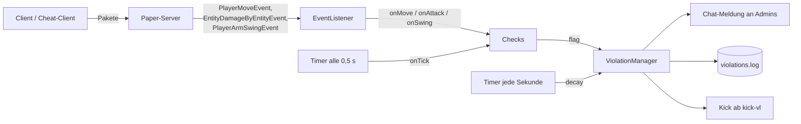

# Architektur

```
src/main/java/dev/schule/anticheat/
├── AntiCheatPlugin.java      Einstiegspunkt: lädt Config, registriert Checks, Listener, Befehl, Timer
├── EventListener.java        empfängt Server-Ereignisse und verteilt sie an alle Checks
├── ViolationManager.java     VL zählen, Admins warnen, Logdatei, Kick, VL abbauen (decay)
├── checks/
│   ├── Check.java            Basisklasse: Config lesen, flag(), allgemeine Ausnahmen
│   ├── FlyCheck.java
│   ├── SpeedCheck.java
│   ├── NoFallCheck.java
│   ├── ReachCheck.java
│   ├── KillAuraCheck.java
│   └── AutoClickerCheck.java
├── commands/
│   └── AcCommand.java        /ac status | alerts | reload
├── data/
│   ├── PlayerData.java       alles, was wir uns pro Spieler merken
│   └── Movement.java         ein Bewegungsschritt (von → nach)
└── util/
    └── BlockUtil.java        Boden, Decke, Eis, Wasser & Co. selbst prüfen
src/main/resources/
├── plugin.yml                Name, Hauptklasse, Befehl, Berechtigungen
└── config.yml                alle Grenzwerte
```

## Ablauf



1. Der Client schickt Bewegungen, Schläge und Klicks an den Server.
2. Paper macht daraus **Ereignisse** (Events). Unser `EventListener` empfängt sie.
3. Der Listener rechnet die Bewegung aus (`Movement`), prüft die Umgebung (`BlockUtil`) und
   ruft bei **jedem** Check die passende Methode auf.
4. Ein Check, der etwas Verdächtiges findet, ruft `flag(...)` auf.
5. Der `ViolationManager` erhöht das VL, meldet es den Admins, schreibt ins Log und kickt ab dem Grenzwert.
6. Jede Sekunde sinken alle VL wieder (`decay`), damit vereinzelte Fehlalarme verschwinden.

## Warum so aufgebaut?

- **Ein Listener für alle Checks:** Die Reihenfolge ist klar (erst Umgebung prüfen, dann Checks,
  dann Zustand speichern). Ein neuer Check braucht nur eine neue Klasse + eine Zeile in `AntiCheatPlugin`.
- **Basisklasse `Check`:** Gemeinsames (Config, Meldung, Ausnahmen) steht nur an einer Stelle.
- **Grenzwerte in der `config.yml`:** Einstellen ohne neu zu programmieren (Soll-Kriterium S7).
- **Logdatei ohne IP-Adressen:** Datensparsamkeit nach DSGVO (Soll-Kriterium S6).
- **Nur Kick, kein Bann:** Über einen dauerhaften Ausschluss entscheidet ein Mensch (DSGVO Art. 22).
