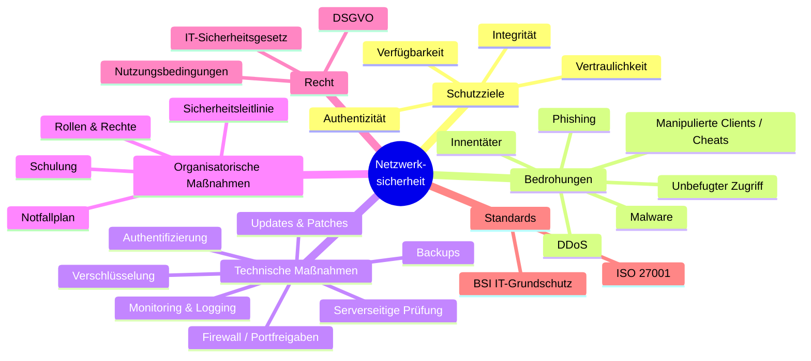

# Sprint 0 – Brainstorming „Netzwerksicherheit“

> **Arbeitsauftrag:** Jeder macht zuerst **allein** ein Brainstorming (Think), dann führen wir es
> zu zweit zusammen (Pair) und tauschen uns mit einer anderen Gruppe aus (Square).
> Ergänzt die Mindmap unten mit euren eigenen Punkten – sie ist nur ein Startpunkt.

## Mindmap

GitHub zeigt den folgenden Block automatisch als Grafik an.

## Einordnung: Warum unser Szenario?

Aus der Mindmap interessiert uns besonders der Ast **„Manipulierte Clients“**: Ein Server
muss mit Geräten kommunizieren, die er **nicht kontrolliert**. Das ist ein Grundproblem vieler
vernetzter Systeme (Webshops, Online-Banking-Apps, Online-Spiele). Ein Minecraft-Server ist
ein anschauliches Beispiel, das wir live vorführen können.

Grundsatz: **„Never trust the client“** – alles, was vom Client kommt, kann gefälscht sein.
Der Server muss Eingaben selbst auf Plausibilität prüfen.

## Kundengespräch (optional)

Leitfaden zur Ermittlung des Schutzbedarfs mit einem (gedachten) Serverbetreiber. Ihr könnt die
Fragen auch im Gespräch mit dem Lehrerteam zur Abstimmung des Soll-Zustands nutzen.

1. **Ziel des Servers:** Wer spielt dort? Wie viele Spieler? Öffentlich oder nur Freunde?
2. **Werte:** Was wäre schlimm, wenn es verloren geht oder manipuliert wird? (Spielwelt, Ranglisten, Ruf der Community)
3. **Bisherige Vorfälle:** Welche Cheats wurden beobachtet? Wie oft?
4. **Folgen:** Was passiert, wenn Cheater nicht erkannt werden? (Spieler wandern ab, Spenden fallen weg)
5. **Personenbezogene Daten:** Welche Daten werden gespeichert? (Spielernamen, UUIDs, IP-Adressen, Chatlogs)
6. **Betrieb:** Wer administriert den Server? Gibt es Backups, Updates, Regeln?
7. **Budget & Aufwand:** Darf eine Lösung Geld kosten? Wie viel Zeit hat der Admin für Pflege?
8. **Akzeptanz:** Wie viele Fehlalarme sind für ehrliche Spieler zumutbar?

Antworten notieren und in [02-schutzbedarf.md](02-schutzbedarf.md) übernehmen.
