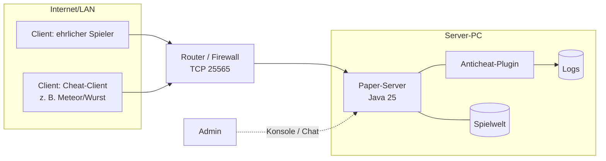

# Lernfeld 11 FISI – Betrieb und Sicherheit vernetzter Systeme gewährleisten

**Szenario X: Betrieb eines frei gewählten vernetzten Systems absichern**

**Unser System:** ein Minecraft-Multiplayer-Server (Paper) im Netzwerk, der von Clients
genutzt wird, die der Betreiber **nicht kontrollieren** kann. Wir analysieren das System,
bestimmen Schutzbedarf und Risiken, entwickeln als zentrale Schutzmaßnahme ein eigenes
serverseitiges Anticheat, prüfen es in einer Live-Demo mit einem öffentlich verfügbaren
Cheat-Client und dokumentieren die Ergebnisse für das Lehrerteam.

## Das vernetzte System

## Aufgabe aus Szenario X → wo wir sie erfüllen

| Arbeitsauftrag Szenario X | Umsetzung | Dokument |
|---|---|---|
| Sprint 0: Brainstorming / Mindmap „Netzwerksicherheit“ | Mindmap, Wahl des Systems | [01-brainstorming.md](01-brainstorming.md) |
| System frei wählen, **Komplexität mit dem Lehrerteam besprechen** | Begründung der Komplexität | [00-auswahl-und-sollzustand.md](00-auswahl-und-sollzustand.md) |
| **Anforderungen (Sicherheitskriterien) gemeinsam festlegen → Soll-Zustand** | Messbare Kriterien S1–S10 | [00-auswahl-und-sollzustand.md](00-auswahl-und-sollzustand.md#soll-zustand-sicherheitskriterien) |
| Informieren (z. B. **BSI**) über **Informationssicherheit** | Schutzziele, BSI-Standards und -Bausteine | [02-schutzbedarf.md](02-schutzbedarf.md) |
| System **analysieren**, **IST-Zustand** definieren | IST-Aufnahme des Servers | [02-schutzbedarf.md](02-schutzbedarf.md#ist-zustand) |
| Risiken benennen (**Schutzbedarfsanalyse**) | Schutzbedarf + Risikomatrix | [02-schutzbedarf.md](02-schutzbedarf.md#schutzbedarfsfeststellung), [03-risikoanalyse.md](03-risikoanalyse.md) |
| Maßnahmen **planen und entwickeln** unter IT-Sicherheitsleitlinien und rechtlichen Regelungen | Leitlinie, Maßnahmenkatalog, DSGVO | [04-massnahmen.md](04-massnahmen.md) |
| Maßnahmen **exemplarisch durchführen** | Anticheat-Plugin (`src/`), Testserver-Härtung | [../architecture.md](../architecture.md), [../checks.md](../checks.md) |
| Sicherheit **prüfen**, Sicherheitsniveau und **Wirtschaftlichkeit bewerten** | Testplan, Soll-Ist-Vergleich, Kosten/Nutzen | [05-pruefung-bewertung.md](05-pruefung-bewertung.md) |
| **Dokumentation** erstellen, **Lehrerteam informieren** | Abschlussbericht + Live-Demo | [06-abschlussbericht.md](06-abschlussbericht.md) |

## Vorgehen (vollständige Handlung)

| Phase | Was wir tun | Ergebnis |
|---|---|---|
| Informieren | Brainstorming, BSI-Standards, Cheat-Arten recherchieren | 01, 02 |
| Planen | IST-Zustand, Schutzbedarf, Risiken, Soll-Zustand | 00, 02, 03 |
| Entscheiden | Maßnahmen auswählen, mit Lehrerteam abstimmen | 00, 04 |
| Durchführen | Testserver aufsetzen und härten, Plugin programmieren | `src/`, Phase 2 + 3 |
| Kontrollieren | Tests mit Cheat-Client und normalem Spiel, Soll-Ist-Vergleich | 05 |
| Bewerten | Sicherheitsniveau, Wirtschaftlichkeit, Grenzen, Präsentation | 05, 06 |

Die GitHub-Arbeitsweise (Issues, Pull Requests, Reviews, Projects Board) dient gleichzeitig
als **Nachweis**, wer welchen Teil geplant, umgesetzt und geprüft hat.
